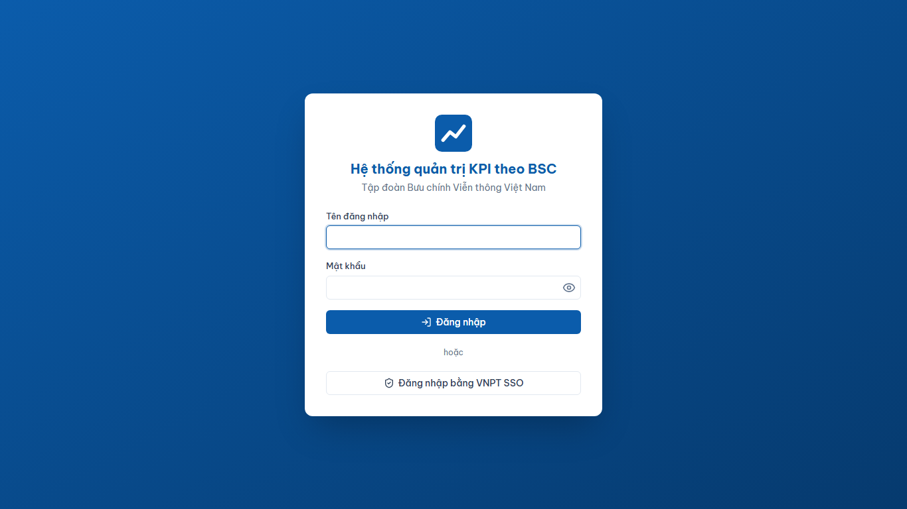
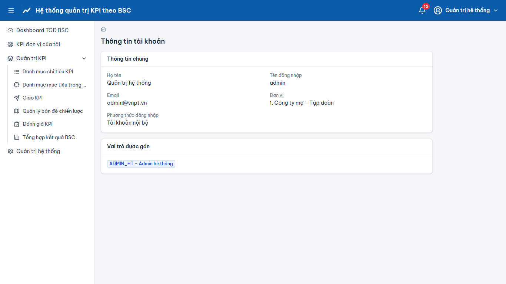
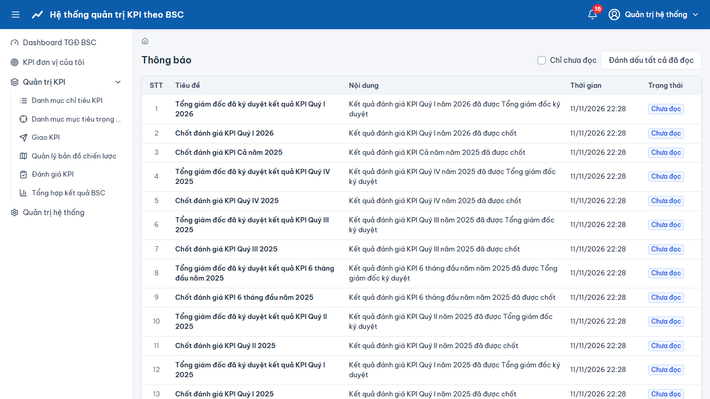

# Đăng nhập, đăng xuất và giao diện chung

> Phạm vi chức năng (mã STT E-HSMT): 1.1, 1.2, 2.1, 54.1

## Đăng nhập (STT 1.1, 1.2)
1. Mở địa chỉ hệ thống (ví dụ `https://kpi.vnpt.vn`) → màn hình **Đăng nhập**.
2. Cách 1 – tài khoản nội bộ: nhập “Tên đăng nhập”, “Mật khẩu” → nhấn **“Đăng nhập”**.
3. Cách 2 – VNPT SSO: nhấn **“Đăng nhập bằng VNPT SSO”** → đăng nhập trên trang CAS của VNPT → hệ thống tự quay lại trang “Dashboard TGĐ BSC”.
4. Sai mật khẩu nhiều lần (mặc định 5 lần) tài khoản bị khóa tạm 15 phút. Tài khoản “Khóa”/“Ngưng hoạt động” không đăng nhập được, hệ thống hiển thị lý do.

## Giao diện chung
- **Thanh trên**: tên hệ thống, chuông **thông báo** (số chưa đọc; “Đánh dấu tất cả đã đọc”, “Xem tất cả”), menu người dùng (Thông tin cá nhân, Đăng xuất).
- **Menu trái**: chỉ hiện các chức năng được phân quyền. **Breadcrumb** cho biết vị trí hiện tại.
- Lưới dữ liệu: tìm kiếm đa tiêu chí, phân trang, sắp xếp theo cột; nút “Thêm mới”, “Sửa”, “Xóa” (luôn có hộp thoại xác nhận), “Nhập dữ liệu”, “Xuất dữ liệu”.
- Thao tác thành công hiện thông báo xanh (ví dụ “Thêm mới thành công”); thất bại hiện lý do; nhập thiếu/sai báo lỗi ngay tại trường.

## Đăng xuất (STT 2.1)
Menu người dùng → **“Đăng xuất”**. Phiên làm việc bị thu hồi; nếu đăng nhập bằng SSO, hệ thống chuyển về trang đăng nhập.

## Ảnh màn hình

**Đăng nhập**

**Thông tin cá nhân**

**Thông báo**

