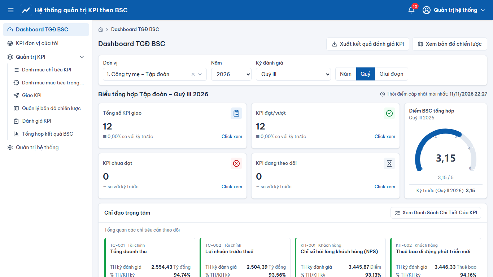
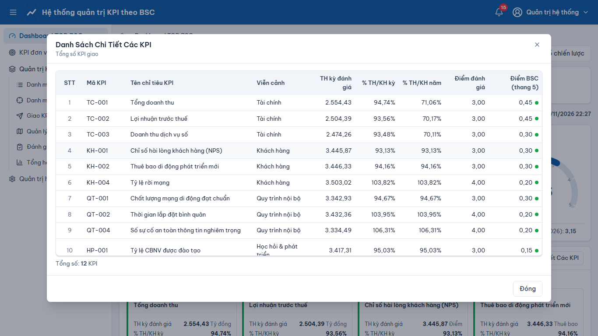
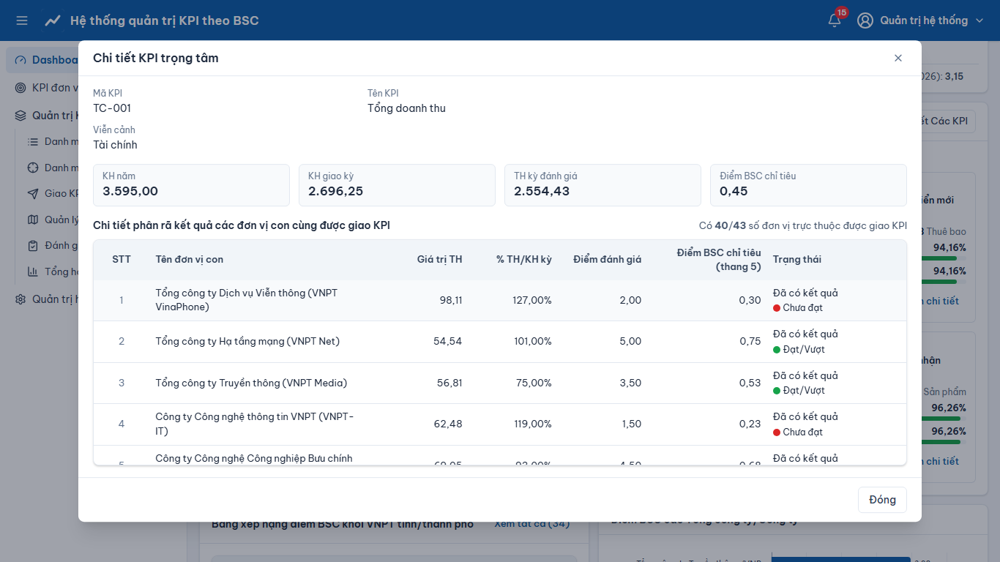
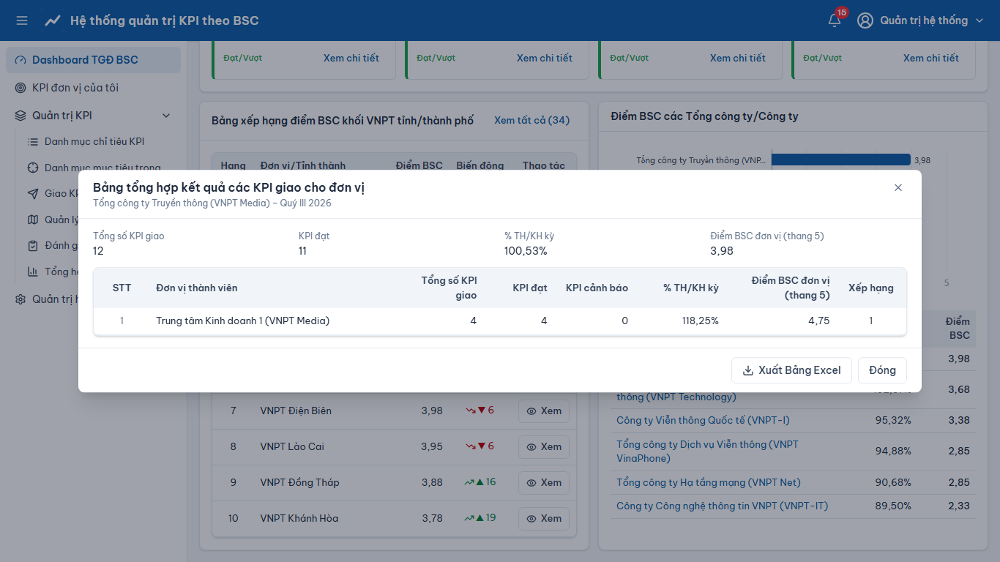
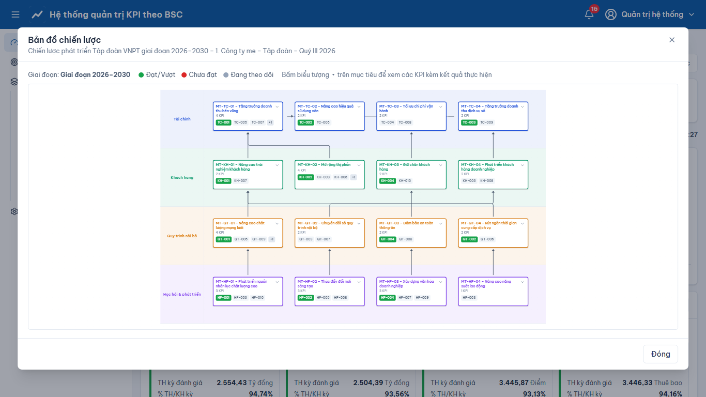
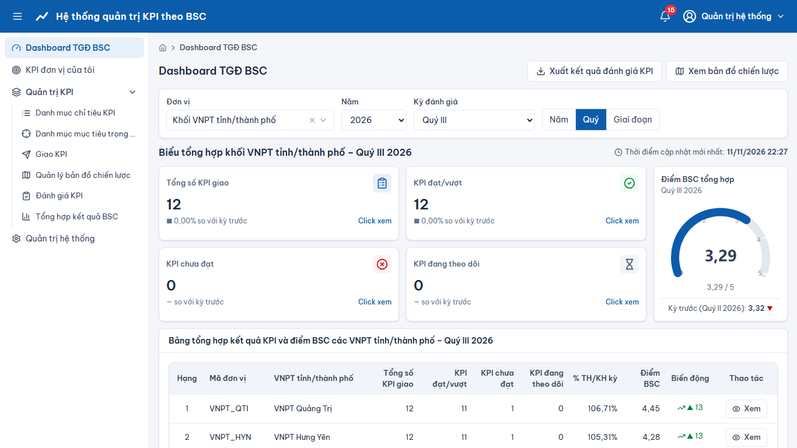

# Dashboard TGĐ BSC

> Phạm vi chức năng (mã STT E-HSMT): 6.1 – 17.8

## Bộ lọc (STT 17.1, 17.2)
- Vào menu **“Dashboard TGĐ BSC”**: hệ thống mở theo mặc định – đơn vị cao nhất trong phạm vi, năm hiện tại, kỳ đánh giá gần nhất đã có kết quả.
- **“Đơn vị”**: “1. Công ty mẹ – Tập đoàn”, “Khối VNPT tỉnh/thành phố” hoặc một đơn vị cụ thể. **“Năm”**. **“Kỳ đánh giá”**: “Cả năm”, “Quý I”…“Quý IV”, “6 tháng đầu năm”, các “Giai đoạn”.
- Nút nhanh **Năm / Quý / Giai đoạn** đi theo sơ đồ điều hướng (SiteMap). Đổi bộ lọc → toàn bộ số liệu được truy vấn lại.

## Các khối số liệu
- 4 thẻ **“Tổng số KPI giao”, “KPI đạt/vượt”, “KPI chưa đạt”, “KPI đang theo dõi”** kèm tỷ lệ so với kỳ trước; nhấn **“Click xem”** → “Danh Sách Chi Tiết Các KPI” của thẻ (17.3).
- **“Điểm BSC tổng hợp”** (thang 5) kèm điểm kỳ trước.
- **“Chỉ đạo trọng tâm”**: thẻ các KPI trọng tâm (“TH kỳ đánh giá”, “% TH/KH kỳ”, “% TH/KH năm”); **“Xem chi tiết”** → chi tiết và phân rã theo đơn vị con (17.5); **“Xem Danh Sách Chi Tiết Các KPI”** → toàn bộ KPI, có tìm kiếm và lọc viễn cảnh (17.4).
- Cấp Tập đoàn: **“Bảng xếp hạng điểm BSC khối VNPT tỉnh/thành phố”** (top 10, “Xem tất cả”; “Xem” → dashboard đơn vị – 16.1) và **“Điểm BSC các Tổng công ty/Công ty”** (nhấn đơn vị → bảng tổng hợp đơn vị thành viên, “Xuất Bảng Excel” – 17.7, 17.8).
- Ở chế độ đơn vị có dòng “Đang xem: <Đơn vị> – <Kỳ>” và nút **“Quay lại Dashboard Tập đoàn”** (16.2).
- “Khối VNPT tỉnh/thành phố”: bảng xếp hạng toàn bộ tỉnh và biểu đồ điểm BSC (12.1, 13.1). Một tỉnh + giai đoạn: biểu đồ và bảng kết quả qua các kỳ (14.1).
- Kỳ “Giai đoạn”: biểu đồ điểm BSC theo năm; **nhấn vào cột một năm** → chuyển sang kết quả cả năm đó (8.1, 11.1).

## Nút trên thanh công cụ
- **“Xuất kết quả đánh giá KPI”** → tải file xlsx (sheet tổng hợp + sheet chi tiết KPI) theo bộ lọc đang chọn (17.6).
- **“Xem bản đồ chiến lược”** → bản đồ chiến lược chỉ đọc của đơn vị/năm (15.1); bấm ▾ trên mục tiêu để xem KPI kèm kết quả.

## Ảnh màn hình

**Dashboard TGĐ BSC**

**Dashboard TGĐ BSC – Danh Sách Chi Tiết Các KPI**

**Dashboard TGĐ BSC – Chi tiết KPI trọng tâm**

**Dashboard TGĐ BSC – Bảng tổng hợp kết quả các KPI giao cho đơn vị**

**Dashboard TGĐ BSC – Bản đồ chiến lược**

**Dashboard TGĐ BSC – Khối VNPT tỉnh/thành phố**

