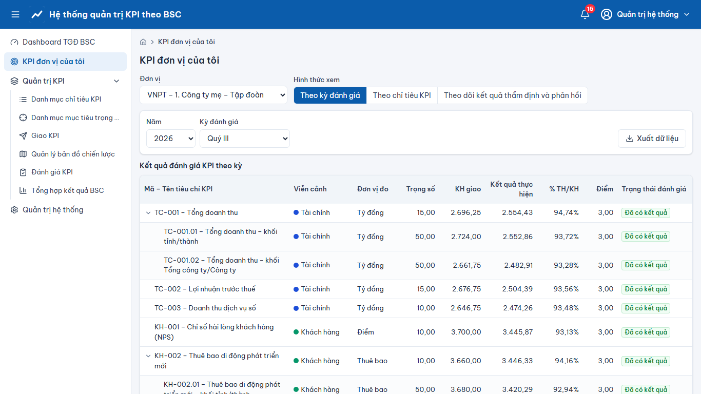

# KPI đơn vị của tôi

> Phạm vi chức năng (mã STT E-HSMT): 18 – 22

1. Menu **“KPI đơn vị của tôi”** → danh sách KPI được giao cho đơn vị theo năm/kỳ (18.x), lọc theo năm, kỳ, viễn cảnh, trạng thái.
2. **Xem chi tiết** một KPI: kế hoạch, kết quả, % TH/KH, điểm, dòng thời gian trạng thái (19.x).
3. **“Đề nghị điều chỉnh”** (21.1): khi không đồng ý với kết quả, nhập giá trị đề nghị, lý do, đính kèm minh chứng → **“Gửi”**. Trạng thái chuyển “ĐV đề nghị điều chỉnh”, người thẩm định nhận thông báo.
4. Theo dõi kết quả xử lý đề nghị và kết quả chốt kỳ (20.x, 22.1).

## Ảnh màn hình

**KPI đơn vị của tôi**

