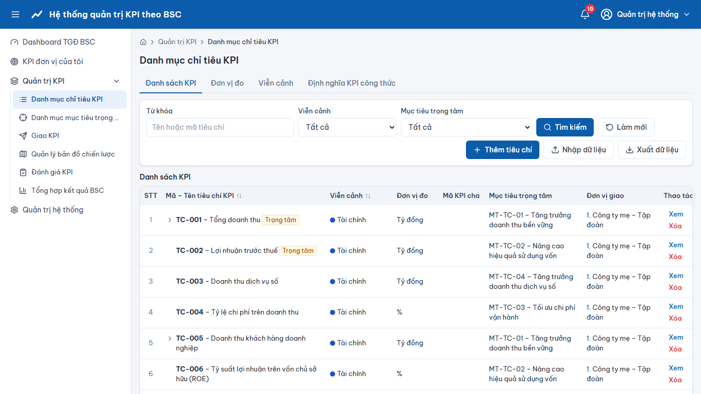
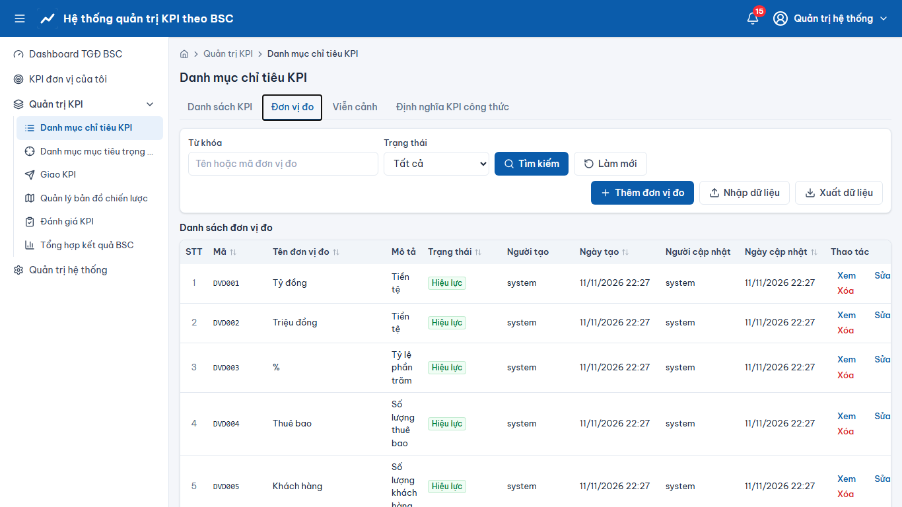
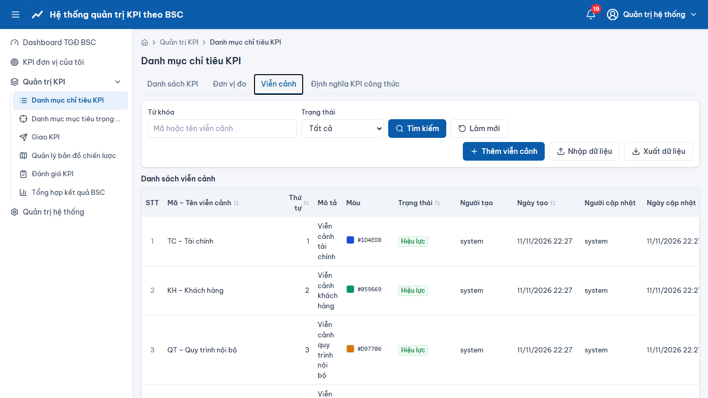
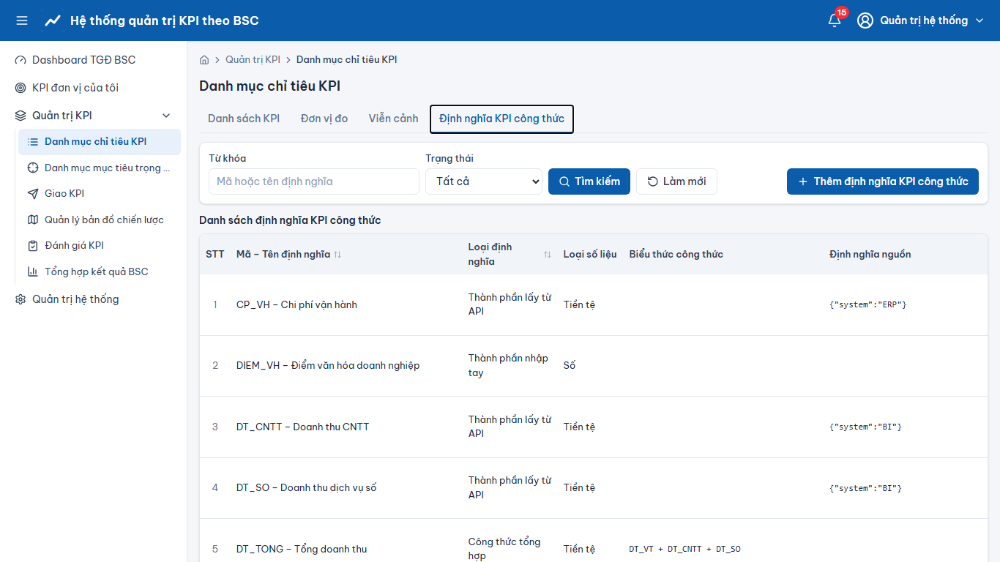
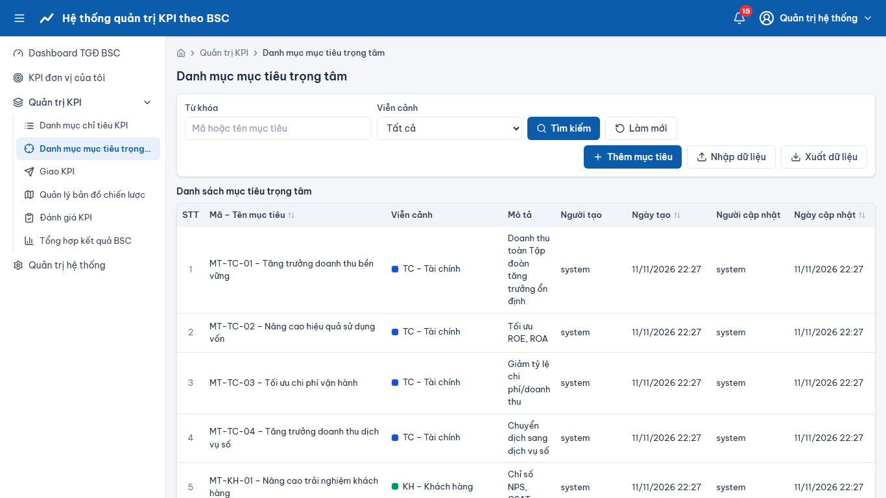

# Quản trị KPI – Danh mục chỉ tiêu KPI, mục tiêu trọng tâm

> Phạm vi chức năng (mã STT E-HSMT): 23 – 28

## Danh mục chỉ tiêu KPI (STT 23)
- Menu **“Quản trị KPI” → “Danh mục chỉ tiêu KPI”**. Lưới dạng cây KPI cha – con; tìm theo mã/tên, viễn cảnh, mục tiêu, trạng thái.
- **“Thêm tiêu chí”** (24.1 KPI đơn lẻ, 25.1 KPI cha – con): chọn “Cấu trúc tiêu chí”, nhập tên, viễn cảnh, mục tiêu trọng tâm, loại số liệu giao, phương pháp tính điểm, cách tính kết quả Tập đoàn, đơn vị/cán bộ giao và đánh giá, đơn vị đo, công thức (**“Kiểm tra biểu thức”**). Mã tiêu chí tự sinh theo viễn cảnh (ví dụ TC-001, KPI con TC-001.01).
- **Sửa / Xóa**: KPI đã giao không đổi được cấu trúc; KPI đang được tham chiếu (đã giao, gắn chiến lược) không xóa được – hệ thống báo lý do. Xóa KPI cha sẽ hỏi xác nhận xóa cả KPI con.
- **“Nhập dữ liệu”** từ file mẫu, **“Xuất dữ liệu”** ra Excel.

## Các danh mục khác (tab, STT 26.x, 27.x)
“Đơn vị đo”, “Viễn cảnh”, “Phương pháp tính điểm”, “Định nghĩa KPI công thức” (thành phần hằng số/API, nút test API), “Nguồn dữ liệu” – cùng mẫu thao tác Thêm mới / Sửa / Xóa / Tìm kiếm / Nhập / Xuất.

## Quản lý mục tiêu trọng tâm (STT 28)
Menu **“Quản lý mục tiêu trọng tâm”**: danh sách mục tiêu theo viễn cảnh; thêm/sửa/xóa, gắn KPI vào mục tiêu.

## Ảnh màn hình

**Danh mục chỉ tiêu KPI**

**Danh mục chỉ tiêu KPI – Đơn vị đo**

**Danh mục chỉ tiêu KPI – Viễn cảnh**

**Danh mục chỉ tiêu KPI – Định nghĩa KPI công thức**

**Quản lý mục tiêu trọng tâm**

