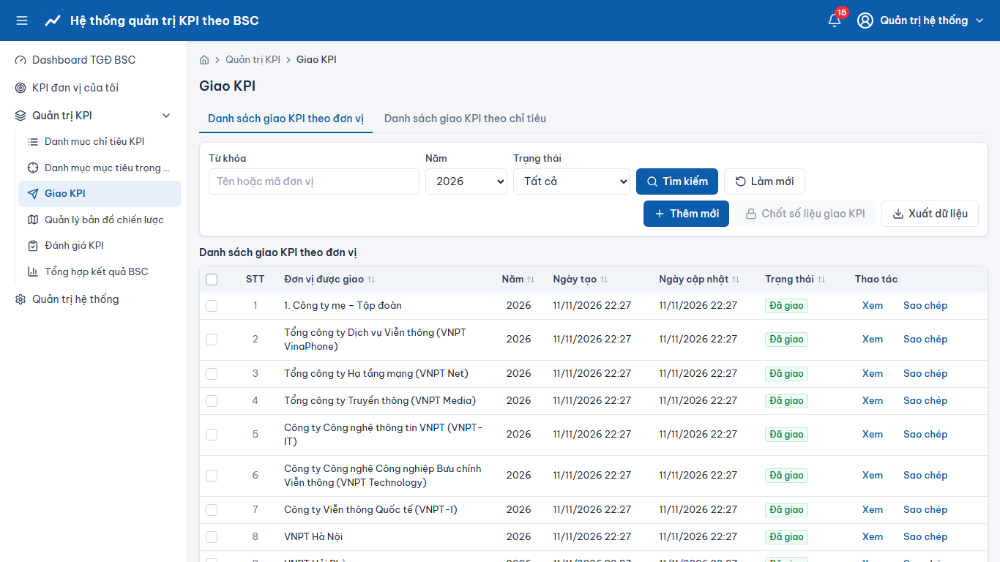
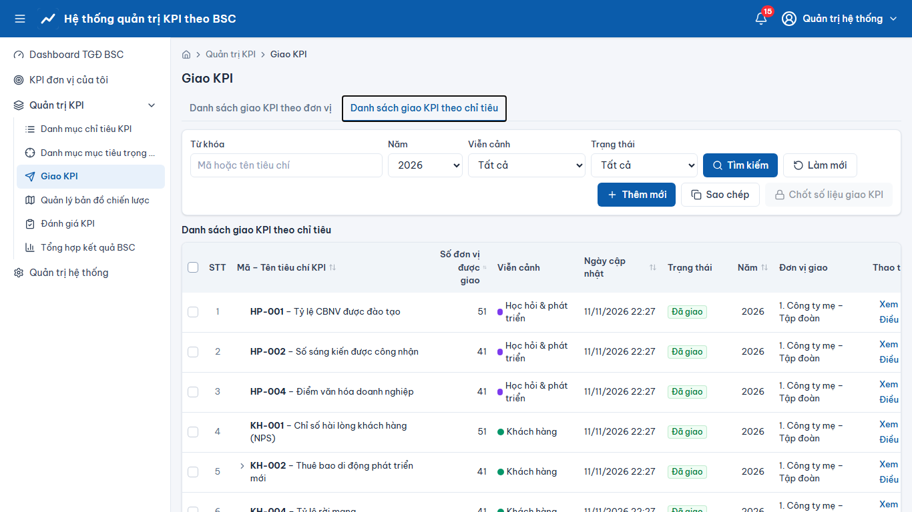

# Quản trị KPI – Giao KPI

> Phạm vi chức năng (mã STT E-HSMT): 29 – 35

## Tab “Danh sách giao KPI theo đơn vị” (29–31)
1. **“Thêm mới”** → chọn “Đơn vị được giao”, “Năm” → thêm các KPI, nhập “Trọng số” (tổng = 100) và mục tiêu Quý I, Quý II, 6T ĐN, Quý III, Quý IV, Cả năm → **“Lưu”** (trạng thái “Nháp”).
2. **“Sao chép”** sang năm khác/đơn vị khác. Tích chọn các dòng → **“Chốt số liệu giao KPI”**: chuyển “Đã giao”, sinh kỳ đánh giá cho đơn vị.
## Tab “Danh sách giao KPI theo chỉ tiêu” (32–33)
Giao một KPI cho nhiều đơn vị cùng lúc; cùng quy tắc trọng số, chốt.
## Điều chỉnh mục tiêu (34)
**“Điều chỉnh mục tiêu giao KPI cho tất cả các đơn vị”**: sửa mục tiêu đã giao → **“Lưu nháp”** hoặc **“Lưu chốt”**; nút **“Lịch sử”** trên từng dòng → “Lịch sử điều chỉnh”.
## Nhập / xuất (35)
**“Nhập dữ liệu”** theo file mẫu (kiểm tra → xem trước → xác nhận); **“Xuất dữ liệu”** ra Excel (sheet tổng hợp + chi tiết).

## Ảnh màn hình

**Giao KPI**

**Giao KPI – Danh sách giao KPI theo chỉ tiêu**

