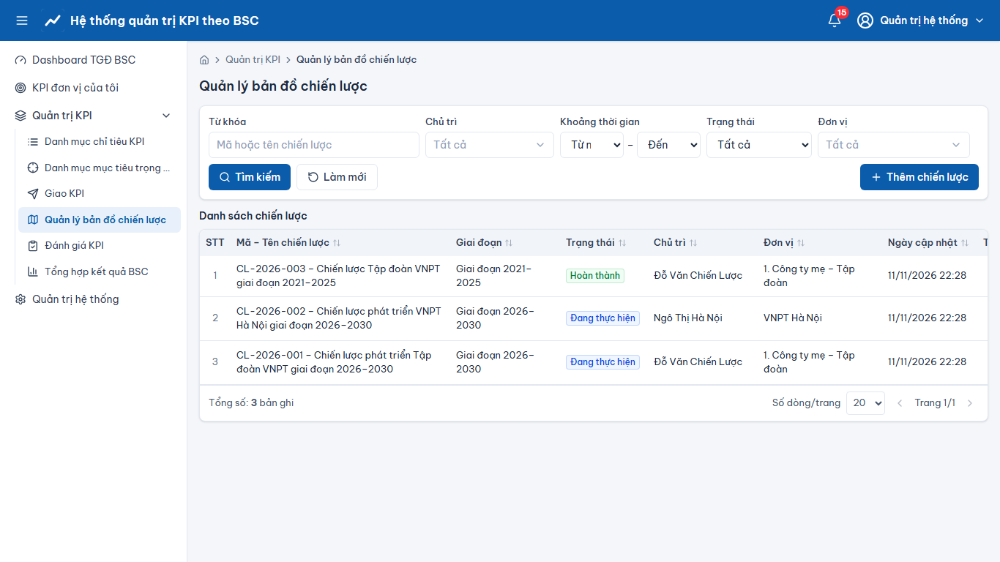
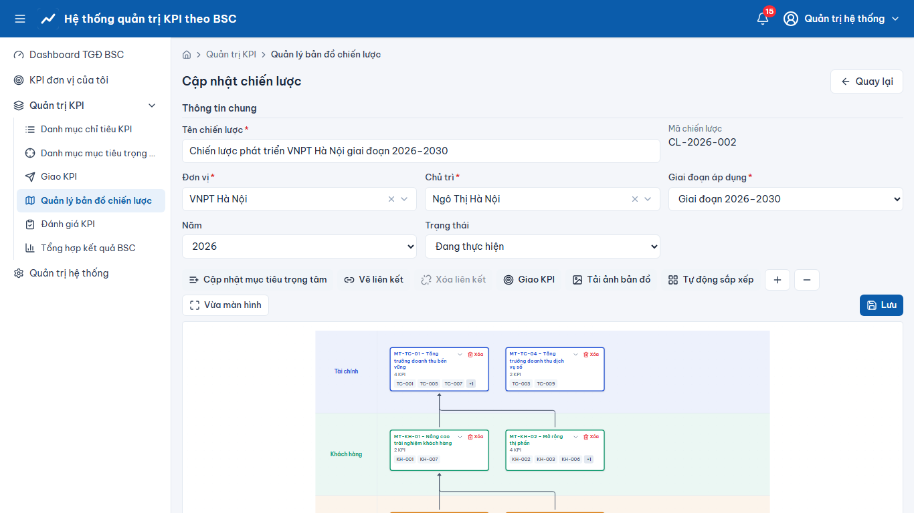

# Quản trị KPI – Quản lý bản đồ chiến lược

> Phạm vi chức năng (mã STT E-HSMT): 36 – 38

1. Menu **“Quản lý bản đồ chiến lược”**: danh sách chiến lược (tìm kiếm, xem, thêm, sửa, xóa – 36.x).
2. **“Sửa”** → màn hình **“Cập nhật chiến lược”**: các dải ngang theo viễn cảnh; **“Cập nhật mục tiêu trọng tâm”** để đặt mục tiêu lên bản đồ; kéo nối điểm (handle) giữa hai mục tiêu để tạo liên kết (mũi tên); nút **“Xóa”** trên thẻ mục tiêu (37.x); **“Tự động sắp xếp”**; **“Lưu”**. Rời trang khi chưa lưu sẽ được cảnh báo.
3. Gán khung KPI cho mục tiêu, xem KPI trên từng thẻ; **“Tải ảnh bản đồ”** (38.1).
4. Job “Hoàn tất chiến lược” tự chuyển chiến lược hết giai đoạn sang “Hoàn thành”.

## Ảnh màn hình

**Quản lý bản đồ chiến lược**

**Quản lý bản đồ chiến lược – Cập nhật chiến lược**

