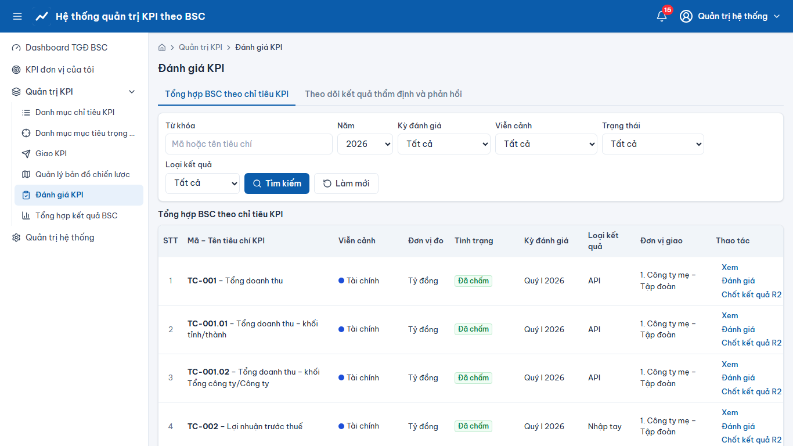
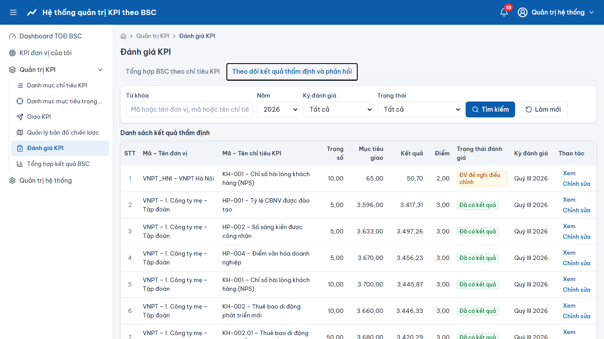

# Quản trị KPI – Đánh giá KPI

> Phạm vi chức năng (mã STT E-HSMT): 39 – 45

1. Menu **“Đánh giá KPI”**: danh sách KPI-kỳ cần đánh giá; lọc năm, kỳ, viễn cảnh, “Tình trạng” (39.x).
2. **Đồng bộ kết quả** từ nguồn dữ liệu (43.1: “Đồng bộ thành công N/M đơn vị; lỗi K”, “Xem lỗi”), hoặc **nhập tay** trên lưới / **nhập từ file** (44.x).
3. Hệ thống tự tính kết quả, % TH/KH, điểm (thang 5), phân loại; **“Chốt KQ R2”** để khóa kết quả theo chỉ tiêu.
4. Tab **“Tổng hợp BSC theo chỉ tiêu KPI”** và **“Theo dõi kết quả thẩm định và phản hồi”**: xử lý đề nghị điều chỉnh của đơn vị (chấp nhận/từ chối, lý do) (41–42).
5. Báo cáo “Biểu giao KPI”, “Biểu kết quả KPI” (45.x).

## Ảnh màn hình

**Đánh giá KPI**

**Đánh giá KPI – Theo dõi kết quả thẩm định và phản hồi**

