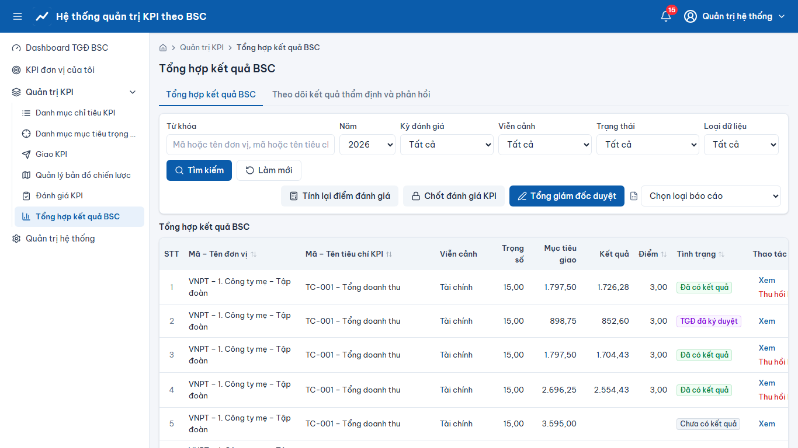
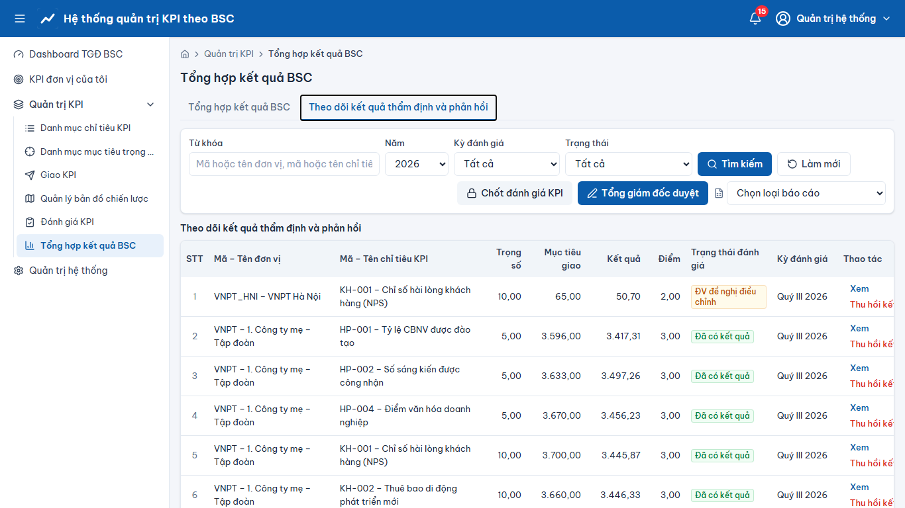

# Quản trị KPI – Tổng hợp kết quả BSC

> Phạm vi chức năng (mã STT E-HSMT): 46 – 54

1. Menu **“Tổng hợp kết quả BSC”**, tab **“Tổng hợp kết quả BSC”**: kết quả mọi đơn vị theo năm/kỳ, xếp hạng; **“Xem”** theo đơn vị/KPI (46.x).
2. **“Thu hồi kết quả đánh giá”** theo KPI hoặc theo đơn vị (46.4, 47.4): kết quả về “BCL yêu cầu làm lại”, đơn vị đánh giá lại. Kỳ đã TGĐ ký duyệt thì không thu hồi được.
3. **“Tính lại điểm đánh giá”** (46.5).
4. **“Chốt đánh giá KPI”** (48.x): chỉ chốt khi mọi đơn vị đủ điều kiện; nếu chưa, hệ thống hiển thị “Danh sách chưa hoàn thành. Vui lòng hoàn thiện trước khi thực hiện chốt đánh giá KPI” kèm danh sách đơn vị. Sau thu hồi, đơn vị đánh giá lại thì chốt lại được.
5. **Tổng giám đốc duyệt** (50.x): xem tổng hợp → **“Ký duyệt”**; kỳ đã duyệt bị khóa toàn bộ.
6. **Báo cáo** (51–53): “Báo cáo TTr94 tổng hợp BSC”, “Báo cáo TTr94 chi tiết KPI”, “Báo cáo KPI từng tỉnh” – chọn phạm vi đơn vị, kỳ → **“Xác nhận”** → tải file.
7. Thông báo (54.1): chuông và email/Zalo cho các sự kiện giao KPI, nhắc hạn, đề nghị điều chỉnh, thu hồi, chốt, duyệt.

## Ảnh màn hình

**Tổng hợp kết quả BSC**

**Tổng hợp kết quả BSC – Theo dõi kết quả thẩm định và phản hồi**

