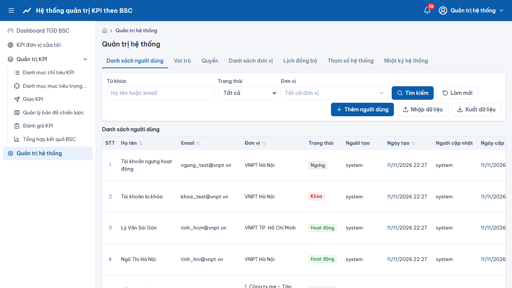
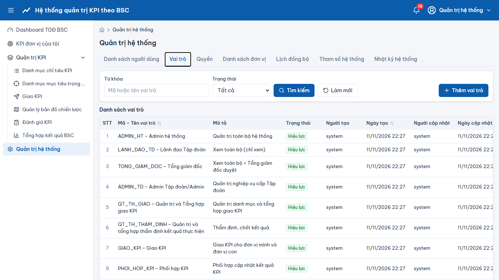
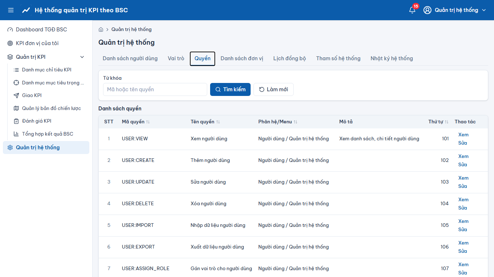
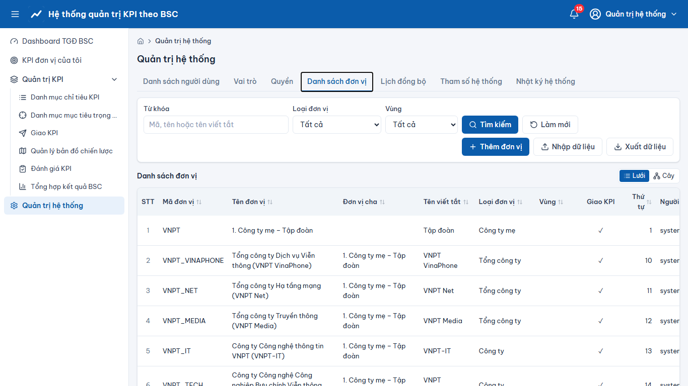
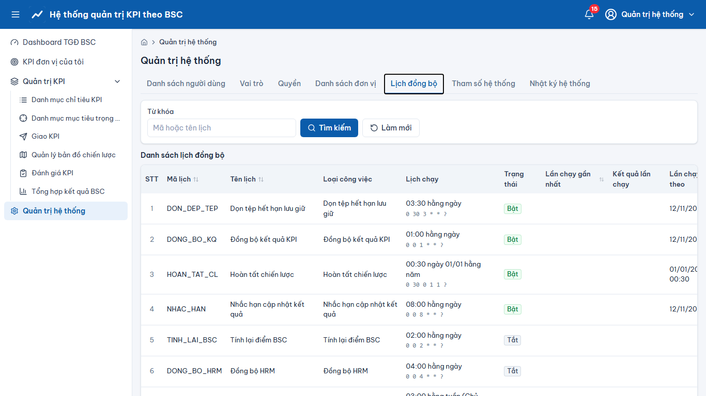
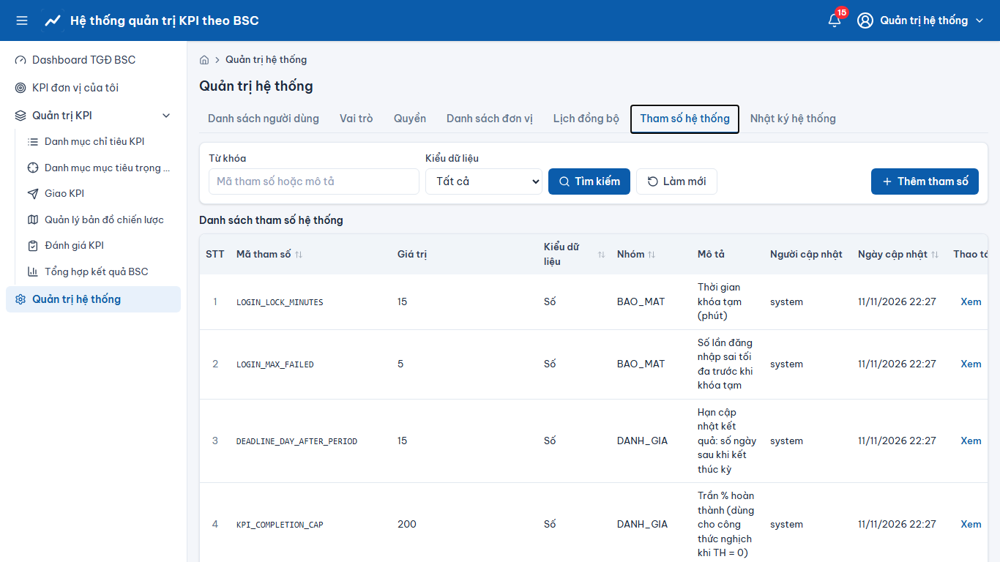
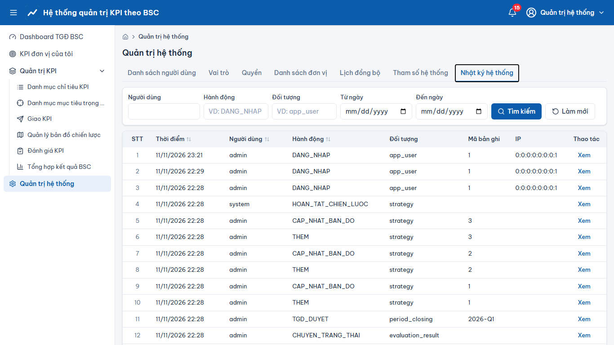

# Quản trị hệ thống

> Phạm vi chức năng (mã STT E-HSMT): 3.x, 4.x, 5.x, 26.17 – 26.24

Menu **“Quản trị hệ thống”**, các tab:
- **Người dùng** (3.x): thêm/sửa/xóa, khóa/mở, nhập/xuất; **“Quản lý vai trò người dùng”**: tích chọn vai trò ở “Vai trò có sẵn” → **“Lưu”** (hoặc “Thêm →” để chọn đơn vị áp dụng); bỏ tích ở “Vai trò đã gán” để bỏ gán.
- **Vai trò / Quyền** (4.x): tạo nhóm quyền, gán quyền theo phân hệ/menu.
- **Đơn vị** (5.x): cây đơn vị/phòng ban, thêm/sửa/xóa, nhập/xuất.
- **Lịch đồng bộ** (26.17–26.19): bật/tắt, sửa cron, “Chạy ngay”, xem lịch sử chạy.
- **Tham số hệ thống** (26.20–26.24): ngưỡng điểm, hạn cập nhật, bảo mật đăng nhập, tích hợp… Sửa có hiệu lực ngay trên node hiện tại và tối đa 30 giây trên node còn lại.
- **Nhật ký hệ thống**: tra cứu thao tác ghi (trước/sau), đăng nhập/đăng xuất.

Chi tiết quản trị: [docs/HDQT.md](../HDQT.md).

## Ảnh màn hình

**Quản trị hệ thống**

**Quản trị hệ thống – Vai trò**

**Quản trị hệ thống – Quyền**

**Quản trị hệ thống – Danh sách đơn vị**

**Quản trị hệ thống – Lịch đồng bộ**

**Quản trị hệ thống – Tham số hệ thống**

**Quản trị hệ thống – Nhật ký hệ thống**

