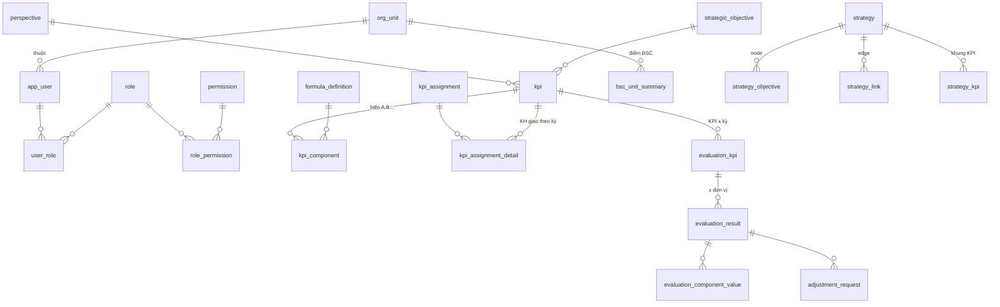
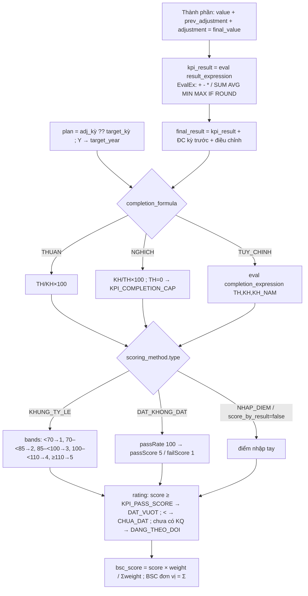

# KIẾN TRÚC HỆ THỐNG — Phần mềm quản trị KPI theo BSC (KPI-BSC)

> Tài liệu bàn giao. Mô tả kiến trúc **đúng theo mã nguồn hiện tại** (backend `backend/`, frontend `frontend/`, triển khai `deploy/`).
> Đối chiếu đặc tả: `docs/SPEC.md` PHẦN B. Điểm nào đặc tả có mà code chưa có được ghi rõ “**Chưa triển khai**”.
> Tài liệu liên quan: `docs/ATTT.md` (bảo mật), `deploy/TRIEN-KHAI.md` (cài đặt), `docs/VAN-HANH.md` (vận hành), `docs/HDQT.md` (quản trị).

---

## 1. Tổng quan

- Quản lý vòng đời KPI: danh mục → gắn chiến lược → giao chỉ tiêu → nhập/đồng bộ kết quả → đánh giá → điều chỉnh → chốt/duyệt → tổng hợp BSC & báo cáo.
- Một SPA (React 19) duy nhất; **toàn bộ luật nghiệp vụ, phân quyền, phạm vi dữ liệu nằm ở backend** (Spring Boot 3.5, Java 21).
- Dữ liệu bảng ở MariaDB 10.11, tệp nhị phân ở MinIO, lịch job do Quartz (JDBC JobStore, clustered) điều phối.
- Cấu hình qua biến môi trường (`/etc/kpi/secrets.env`) + profile Spring (`dev`, `prod`) + bảng `sys_config` (tham số nghiệp vụ sửa được trên UI).

| Lớp | Công nghệ | Vị trí trong source |
|---|---|---|
| Giao diện | React 19, TypeScript 5, Vite 7, TanStack Router/Query, Zustand, Tailwind 4, ECharts, XYFlow + Dagre, i18next | `frontend/src` |
| Dịch vụ | Spring Boot 3.5.16 (Web, Security, Validation, Quartz, Mail, Actuator), jjwt 0.12, Springdoc 2, EvalEx 3, POI + JXLS 2, Tika | `backend/src/main/java/vn/vnpt/kpi` |
| Truy cập dữ liệu | MyBatis (mapper Java + XML), HikariCP, Flyway | `backend/src/main/resources/mapper/**`, `db/migration` |
| Lưu trữ | MariaDB 10.11 (schema `kpi_bsc`), MinIO (SDK 8.5) | `deploy/` |
| Hạ tầng | Nginx (SPA + reverse proxy `/api`), systemd, F5 | `deploy/nginx`, `deploy/systemd` |

---

## 2. Mô hình triển khai và luồng request

```mermaid
flowchart LR
    U[Trình duyệt] -->|HTTPS 443| F5[F5 VIP<br/>round robin]
    F5 -->|443 / health :80 /healthz| N1[Nginx APP_01]
    F5 --> N2[Nginx APP_02]
    N1 -->|/ → SPA tĩnh /opt/kpi-bsc/web| N1
    N1 -->|/api/* → 127.0.0.1:8088| B1[Spring Boot node 1<br/>context-path /api]
    N2 -->|/api/*| B2[Spring Boot node 2]
    B1 & B2 -->|JDBC kpi_app| M[(MariaDB MASTER<br/>DB_01)]
    M -->|GTID replication| S[(MariaDB SLAVE<br/>DB_02)]
    B1 & B2 -->|S3 API| MI[(MinIO DB_01<br/>bucket MINIO_BUCKET)]
    MI -.->|mc mirror (cron/giờ)| MI2[(MinIO DB_02)]
    B1 & B2 -.->|QRTZ_* trên MariaDB<br/>isClustered=true| M
    B1 & B2 -->|serviceValidate| CAS[VNPT CAS/SSO]
    B1 & B2 -->|RestClient| SRC[API nguồn số liệu KPI]
    B1 & B2 -->|SMTP| MAIL[Mail server]
    B1 & B2 -->|ZNS| ZALO[Zalo OA]
    U -.->|presigned URL TTL 300s<br/>mở trực tiếp| MI
```

**Luồng một request API** (ví dụ `GET /api/kpis`):

1. Trình duyệt gửi request kèm cookie `ACCESS_TOKEN` (HttpOnly, Path `/api`) và, với request ghi, header `X-XSRF-TOKEN` lấy từ cookie `XSRF-TOKEN` (`frontend/src/api/http.ts`).
2. F5 cân bằng tải sang Nginx của một trong hai APP node (không cần sticky session — backend stateless).
3. Nginx (`deploy/nginx/kpi.conf`): áp `limit_req` (`kpi_api` 50 r/s; `kpi_login` 10 r/phút cho `/api/auth/login`), thêm header bảo mật, proxy sang `upstream kpi_backend` = `127.0.0.1:8088` với `X-Real-IP`, `X-Forwarded-*` (`kpi-proxy.conf`).
4. Spring Boot (context path `/api`):
   - `TraceIdFilter` gán `traceId` (MDC + header `X-Trace-Id`).
   - `JwtAuthenticationFilter`: lấy token từ `Authorization: Bearer` hoặc cookie, kiểm chữ ký HS512 + hạn + issuer, nạp user/quyền **từ DB** qua `UserAuthorityService` (cache Caffeine 60s).
   - CSRF double-submit (`CookieCsrfTokenRepository`), CORS whitelist.
   - Controller → `@PreAuthorize("hasAuthority('<MÃ>')")` → Service → `DataScopeService` lọc theo phạm vi đơn vị → Mapper MyBatis → MariaDB.
   - Response envelope `ApiResponse { success, code, message, data, errors, traceId }`.
5. Thao tác ghi: service ghi `audit_log` cùng transaction (`AuditService`), sau commit phát sự kiện tính lại (`@TransactionalEventListener(AFTER_COMMIT)`) và gửi thông báo (`@Async`).

**Tệp:** upload qua `POST /api/files` (multipart) → kiểm tra → lưu MinIO. Tải xuống: `GET /api/files/{id}/url` trả presigned URL (TTL 300s) sau khi kiểm quyền; frontend mở URL bằng `window.open` → **trình duyệt người dùng phải truy cập được `MINIO_ENDPOINT`** (xem `deploy/TRIEN-KHAI.md` §7).

### 2.1 Bố trí máy chủ (PHẦN B §10)

| VM | Vai trò | Thành phần chạy |
|---|---|---|
| DTC_BSC_APP_01 | App node 1 | Nginx, `kpi-bsc.service` (Java 21), Quartz node 1 |
| DTC_BSC_APP_02 | App node 2 | Nginx, `kpi-bsc.service`, Quartz node 2 |
| DTC_BSC_DB_01 | DB chính | MariaDB MASTER, MinIO (primary), cron `backup.sh` |
| DTC_BSC_DB_02 | DB dự phòng | MariaDB SLAVE (GTID), MinIO (mirror) |

> Lưu ý: unit systemd hiện đặt `-Xms1g -Xmx3g` (đặc tả PHẦN B §10 ghi `-Xmx12g`). Điều chỉnh khi triển khai thật — xem `deploy/TRIEN-KHAI.md`.

### 2.2 Tính sẵn sàng

- 2 node stateless sau F5; health check `GET /api/actuator/health/readiness` (hoặc `GET /healthz` cổng 80 do Nginx chuyển tiếp).
- `server.shutdown=graceful`, `spring.lifecycle.timeout-per-shutdown-phase=30s`, Quartz `wait-for-jobs-to-complete-on-shutdown=true`; systemd `TimeoutStopSec=60`.
- Quartz clustered: mỗi lịch chỉ chạy trên **một** node tại một thời điểm (`@DisallowConcurrentExecution` + khóa `QRTZ_LOCKS`). Đồng hồ hai node phải đồng bộ NTP.
- Datasource read-replica (`READ_REPLICA_ENABLED`, `DB_REPLICA_URL`): khóa cấu hình đã có trong `application.yml` nhưng **chưa có code sử dụng** → mọi truy vấn hiện đi vào MASTER. Slave chỉ đóng vai trò dự phòng/failover thủ công.

---

## 3. Backend

Package gốc `vn.vnpt.kpi` (`backend/src/main/java/vn/vnpt/kpi`):

| Package | Nội dung chính |
|---|---|
| `config/` | `SecurityConfig` (filter chain, CSRF, CORS, header), `StartupSecurityCheck` (fail-fast prod), `AdminBootstrap`, `MinioConfig`/`MinioProperties`, `MyBatisConfig` (đăng ký `EncryptedStringTypeHandler`), `OpenApiConfig`, `WebConfig` (locale vi/en, MessageSource, executor async `kpi-async-*`). Cấu hình Quartz nằm trong `application.yml` (không có lớp `QuartzConfig` riêng). |
| `security/` | `JwtService`, `JwtAuthenticationFilter`, `AuthController` (`/auth/login`, `/auth/refresh`, `/auth/logout`, `/auth/me`), `VnptSsoController` (`/auth/sso/login`, `/auth/sso/callback`), `CasTicketValidator`, `AuthService`, `AuthCookies`, `LoginRateLimiter`, `LoginAttemptLogger`, `PasswordPolicy`, `UserAuthorityService`, `DataScopeService`, `PermissionCodes`, `MeService` |
| `common/` | `ApiResponse`, `PageQuery` (whitelist sort), `PageResult`, `ErrorCode`, `BusinessException`, `GlobalExceptionHandler`, `audit/` (`AuditService`, `AuditMapper`), `excel/` (import/export dùng chung), `util/` (`TraceIdFilter`, `MaskingConverter`, `EncryptedStringTypeHandler`, `Jsons`, `RequestInfo`) |
| `modules/` | `user`, `role`, `permission`(trong role), `org`, `catalog` (uom, perspective, objective, formula, kpi, scoring), `assignment`, `strategy`, `evaluation`, `bsc`, `dashboard`, `report`, `mykpi`, `notification`, `file`, `sync`, `sysconfig`, `schedule` |
| `engine/` | `KpiCalculationEngine` (hàm thuần), `FormulaEvaluator` (EvalEx) |
| `job/` | `ScheduledJob` (Quartz job chung), `JobRunner`, các `*JobHandler` theo `job_type` |
| `integration/` | `kpisource/` (`KpiSourceClient`, `RestKpiSourceClient`), `hrm/` (`HrmClient`, `StubHrmClient`), `mail/` (`MailNotifier`), `zalo/` (`ZaloNotifier`, `ZnsZaloNotifier`). CAS nằm trong `security/`. |
| `demo/` | `DemoDataSeeder` + các bước seed demo, chỉ chạy khi `KPI_DEMO_SEED=true` (mặc định `true` ở dev, **phải `false` ở prod**) |

Ghi chú: thư mục `orchestrator/` mô tả trong CLAUDE.md **không tồn tại**; logic điều phối nằm trong các service (`EvaluationService`, `SyncService`, `BscService`, `EvaluationCalcService`, `BscSummaryService`).

### 3.1 Controller theo nhóm chức năng

| Mã | Phân hệ | Controller | Đường dẫn chính (sau `/api`) |
|---|---|---|---|
| F01 | Quản trị | `UserController`, `RoleController`, `OrgUnitController`, `ScheduleController`, `SysConfigController` | `/users`, `/roles`, `/permissions`, `/org-units`, `/schedules`, `/sys-configs`, `/audit-logs` |
| F02 | Thiết lập KPI | `CatalogController`, `FormulaController`, `KpiController` | `/uoms`, `/perspectives`, `/objectives`, `/scoring-methods`, `/stages`, `/formula-definitions`, `/kpis` |
| F03 | Chiến lược | `StrategyController` | `/strategies` |
| F04 | Giao KPI | `AssignmentController` | `/assignments/by-unit`, `/assignments/by-kpi`, `/assignments/details/{id}/history` |
| F05 | Đánh giá | `EvaluationController`, `MyKpiController` | `/evaluations/**`, `/my-kpi/**` |
| F06 | BSC & báo cáo | `BscController`, `DashboardController` | `/bsc/**`, `/reports/**`, `/dashboard/**` |
| F07 | Tệp & thông báo | `FileController`, `NotificationController` | `/files`, `/notifications` |

Tài liệu API trực tuyến: Swagger UI `/api/docs`, OpenAPI JSON `/api/docs/api-docs` (Springdoc).

### 3.2 Cấu hình quan trọng (`application.yml`)

| Khóa | Giá trị/biến | Ghi chú |
|---|---|---|
| `server.port` | `SERVER_PORT` (mặc định 8088) | Nginx proxy tới `127.0.0.1:8088` |
| `server.servlet.context-path` | `/api` | Actuator ở `/api/actuator/*` |
| `spring.datasource.*` | `DB_URL`, `DB_USER`, `DB_PASSWORD`, `DB_POOL_MAX` (30) | Hikari pool `kpi-hikari` |
| `spring.flyway.*` | `DB_MIGRATE_USER`, `DB_MIGRATE_PASSWORD` | Flyway chạy **lúc ứng dụng khởi động** bằng user DDL riêng |
| `spring.quartz.*` | JDBC store, `isClustered=true`, `threadCount=5`, `clusterCheckinInterval=15000` | Bảng `QRTZ_*` tạo bởi `V002__quartz.sql` (`initialize-schema: never`) |
| `spring.cache.caffeine.spec` | `maximumSize=5000,expireAfterWrite=60s` | |
| `management.endpoints.web.exposure.include` | `health,info` | probes liveness/readiness bật |
| `kpi.security.*`, `kpi.cas.*`, `kpi.minio.*`, `kpi.kpi-source.*`, `kpi.clamav.*`, `kpi.zalo.*`, `kpi.mail.*`, `kpi.hrm.*` | xem `deploy/env.example` | |

Profile `prod` (`application-prod.yml`): bắt buộc `DB_URL`, thêm `sslMode=${DB_SSL_MODE:verify-full}` cho JDBC, `cookie-secure: true`, Swagger UI bật/tắt bằng `SWAGGER_ENABLED`, log JSON (`logback-spring.xml`).

---

## 4. Frontend

```
frontend/src/
├── main.tsx                # khởi tạo React, QueryClient, i18n, Router
├── app/                    # AppLayout, Header, Sidebar, Breadcrumb, ErrorBoundary, NotificationBell
├── routes/index.tsx        # khai báo route code-based (lazy) ; authGuards.ts (guard theo quyền)
├── api/http.ts             # Axios: withCredentials, Accept-Language, X-XSRF-TOKEN, refresh 1 lần khi 401, 403 → /forbidden, upload/download
├── api/endpoints.ts, types.ts
├── features/<domain>/      # assignment, bsc, catalog, dashboard, evaluation, mykpi, strategy, system, common
├── pages/                  # LoginPage, StatusPages (forbidden/not-found/sso-error), ProfilePage, NotificationsPage
├── stores/                 # sessionStore, filterStore, uiStore (Zustand)
├── components/ui|data-grid|import-export
├── i18n/vi.json, en.json
└── lib/                    # format (ngày dd/MM/yyyy, số 1.234.567,89), utils
```

Route chính: `/login`, `/sso-error`, `/dashboard`, `/my-kpi`, `/kpi-admin/catalog`, `/kpi-admin/objectives`, `/kpi-admin/assignments[/unit/$id | /kpi/$kpiId/$year[/adjust]]`, `/kpi-admin/strategies[/$id]`, `/kpi-admin/evaluations[/$evalKpiId]`, `/kpi-admin/bsc`, `/system?tab=users|roles|permissions|org-units|schedules|sys-configs|audit`, `/profile`, `/notifications`, `/forbidden`.

Build: `npm run build` → `frontend/dist` → triển khai vào `/opt/kpi-bsc/web` (Nginx `root`). `VITE_API_BASE_URL` mặc định `/api` (cùng origin, không cần CORS ở prod).

---

## 5. Mô hình dữ liệu

Schema `kpi_bsc`, charset `utf8mb4` / `utf8mb4_vietnamese_ci`, enum lưu `VARCHAR` + `CHECK`. Bảng nghiệp vụ có `created_by/at`, `updated_by/at`, `version` (optimistic lock), `deleted` (soft delete; mã UNIQUE dùng cột sinh `uk_code`/`uk_key` để cho phép tạo lại mã đã xóa mềm).

Migration (`backend/src/main/resources/db/migration`):

| File | Nội dung |
|---|---|
| `V001__init.sql` | 45 bảng nghiệp vụ (dưới đây), `audit_log` partition theo tháng |
| `V002__quartz.sql` | Bảng chuẩn Quartz `QRTZ_*` (tables_mysql_innodb, Quartz 2.5.2) |
| `V003__seed_identity.sql` | Quyền (`permission`), 11 vai trò seed, gán quyền mặc định |
| `R__seed_01_config.sql` | Menu, `sys_config`, `scoring_method`, `evaluation_stage`, `perspective`, `sync_schedule`, `report_template` |
| `R__seed_02_org.sql` | Cây đơn vị (Tập đoàn, TCT/Công ty, 34 VNPT tỉnh/thành), tài khoản `admin` |
| `db/seed-dev/R__seed_9x_*.sql` | Chỉ profile dev: tài khoản test, danh mục mẫu |

| Nhóm | Bảng |
|---|---|
| Tổ chức/danh tính | `org_unit`, `app_user`, `role`, `permission`, `menu`, `role_permission`, `user_role`, `user_session`, `login_log` |
| Danh mục KPI | `unit_of_measure`, `perspective`, `strategic_objective`, `formula_definition`, `scoring_method`, `evaluation_stage`, `kpi`, `kpi_code_sequence`, `kpi_component` |
| Chiến lược | `strategy`, `strategy_objective`, `strategy_link`, `strategy_kpi` |
| Giao KPI | `kpi_assignment`, `kpi_assignment_detail`, `kpi_assignment_adjustment`, `kpi_assignment_adjustment_line`, `kpi_assignment_history`, `kpi_officer_map` |
| Đánh giá | `evaluation_kpi`, `evaluation_result`, `evaluation_component_value`, `adjustment_request`, `evaluation_feedback`, `evaluation_status_history`, `period_closing`, `sync_batch`, `sync_batch_item`, `formula_result` |
| BSC/báo cáo | `bsc_unit_summary`, `report_template` |
| Quản trị/hạ tầng | `sys_config`, `sync_schedule`, `notification`, `file_object`, `audit_log` |
| Quartz | `QRTZ_*` |



Đặc thù: `app_user.phone` mã hóa AES-256-GCM (`EncryptedStringTypeHandler`); `email` để plaintext (UNIQUE, map SSO). `audit_log` không FK, PK `(id, at)`, partition `RANGE (TO_DAYS(at))` từ `p2025`, `p202601` … `p202706`, `pmax` — **cần bảo trì partition trước 07/2027** (`docs/VAN-HANH.md` §6).

---

## 6. Engine tính điểm

`engine/KpiCalculationEngine` là **hàm thuần** (DTO vào → DTO ra, không phụ thuộc Spring/DB), scale lưu 4, `RoundingMode.HALF_UP`. Tham số lấy từ `sys_config` (`KPI_PASS_SCORE`, `KPI_WARNING_RATE`, `KPI_COMPLETION_CAP`) và `scoring_method.config` (khung điểm) rồi truyền vào `Config`/`Scoring`.



- Chia 0 → kết quả NULL + thông báo lỗi dòng. Kế hoạch NULL/0 với THUAN → không tính, `DANG_THEO_DOI`.
- Sau mỗi lần ghi kết quả/điều chỉnh/đồng bộ: `EvaluationCalcService` tính lại dòng `evaluation_result`, `BscSummaryService` cập nhật `bsc_unit_summary` sau commit (async). Nút “Tính lại điểm đánh giá” (`POST /api/bsc/recalculate`) chạy đồng bộ cho (năm, kỳ).
- Các giả định (khung điểm, KPI cha–con, ĐC kỳ trước, giai đoạn…) liệt kê tại `docs/OPEN-QUESTIONS.md` #3, #4.

---

## 7. Lịch job (Quartz)

Lịch lưu trong `sync_schedule`, nạp vào Quartz khi khởi động (`ScheduleService`, múi giờ `Asia/Ho_Chi_Minh`, misfire = DoNothing). Sửa cron trên UI → reschedule ngay. “Chạy ngay” → `scheduler.triggerJob` (ghi `sync_batch.trigger = USER`).

| Mã | job_type | Cron seed | Bật | Handler |
|---|---|---|---|---|
| DONG_BO_KQ | DONG_BO_KET_QUA_KPI | `0 0 1 * * ?` (01:00 hằng ngày) | 1 | `KpiSyncJobHandler` — params `{"year":..,"periods":[..]}` |
| HOAN_TAT_CL | HOAN_TAT_CHIEN_LUOC | `0 30 0 1 1 ?` (00:30 ngày 01/01) | 1 | `StrategyCompleteJobHandler` |
| NHAC_HAN | NHAC_HAN_CAP_NHAT | `0 0 8 * * ?` | 1 | `ReminderJobHandler` |
| TINH_LAI_BSC | TINH_LAI_BSC | `0 0 2 * * ?` | 0 | `BscRecalcJobHandler` |
| DONG_BO_HRM | DONG_BO_HRM | `0 0 4 * * ?` | 0 | `HrmSyncJobHandler` (stub) |
| SAO_LUU | SAO_LUU_LOGIC | `0 0 3 ? * SUN` | 1 | `LogicalBackupJobHandler` — params `{"keep":8}` |

---

## 8. Tích hợp

| Hệ thống | Hiện trạng | Cấu hình |
|---|---|---|
| **VNPT CAS/SSO** | Đã triển khai: `/auth/sso/login` redirect `${CAS_SERVER_URL}/login?service=…`; callback validate ticket (`/serviceValidate` khi `CAS_PROTOCOL=2.0`, `/p3/serviceValidate` khi `3.0`), parse XML chống XXE, map `app_user` theo username hoặc email (bỏ qua user `auth_source=LOCAL`), phát cookie JWT, redirect `${KPI_FRONTEND_URL}dashboard`. SLO khi `CAS_SLO_ENABLED=true` (trả `casLogoutUrl` cho FE). Dev: `deploy/mocks/mock-cas.mjs` cổng 8091. | `CAS_ENABLED`, `CAS_SERVER_URL`, `CAS_SERVICE_URL`, `CAS_PROTOCOL`, `CAS_SLO_ENABLED`, `KPI_FRONTEND_URL` (**phải kết thúc bằng `/`**) |
| **Nguồn số liệu KPI** | `RestKpiSourceClient`: base URL `sys_config.KPI_SOURCE_BASE_URL`, `api_path` có placeholder `{year}`, `{period}`, `{unitCode}`, `{kpiCode}`, GET/POST, JSONPath `response_path` (mặc định `$.value`); xác thực theo `KPI_SOURCE_AUTH_TYPE` (NONE/API_KEY/BEARER/BASIC); timeout 10s, retry 2 lần (backoff 300ms×n), circuit breaker 5 lỗi liên tiếp → mở 30s; ghi `sync_batch_item`. Dev: `mock-kpi-source.mjs` cổng 8092. | `KPI_SOURCE_*` (env, secret) + `sys_config` |
| **VNPT HRM** | **Chỉ có stub** (`StubHrmClient` trả danh sách rỗng); job DONG_BO_HRM tắt; cột `hrm_ref` đã có. Chờ đặc tả API (OPEN-QUESTIONS #6). | `HRM_ENABLED=false` |
| **Email** | `MailNotifier` (Spring Mail, `SimpleMailMessage`, tiêu đề tiền tố `[KPI-BSC]`). Bật bằng `sys_config.NOTIFY_EMAIL_ENABLED`. Dev: Mailpit 1026/8026. | `SMTP_HOST/PORT/USER/PASSWORD`, `MAIL_FROM` |
| **Zalo ZNS** | `ZnsZaloNotifier` POST `https://business.openapi.zalo.me/message/template` với `access_token`, `template_id` = `sys_config.ZALO_TEMPLATE_<EVENT>`; bỏ qua nếu thiếu token/template/số điện thoại. Bật bằng `NOTIFY_ZALO_ENABLED`. | `ZALO_ACCESS_TOKEN` |
| **ClamAV** | Hook `clamd` INSTREAM qua TCP, tắt mặc định | `CLAMAV_ENABLED/HOST/PORT` |

Sự kiện thông báo (`NotificationService`): `GIAO_KPI`, `NHAC_HAN`, `DE_NGHI_DIEU_CHINH`, `XU_LY_DIEU_CHINH`, `CHOT_KET_QUA`, `TGD_DUYET`, `DIEU_CHINH_MUC_TIEU`, `THU_HOI`. Kênh: chuông trong ứng dụng (luôn), email/Zalo (theo tham số). SSE `GET /api/notifications/stream` (tùy chọn trong đặc tả) **chưa triển khai** — FE dùng polling.

---

## 9. Quan sát & hỗ trợ

- Log: stdout → journald (`journalctl -u kpi-bsc`); prod định dạng JSON (Logback `JsonEncoder`) kèm MDC `traceId`, `username`; dev dạng text có che token.
- `GET /api/actuator/health`, `/health/liveness`, `/health/readiness`, `/info` (build version/time từ `spring-boot-maven-plugin:build-info` + `info.app.*`).
- Chưa có endpoint metrics (Prometheus) — chỉ mở `health,info`.
